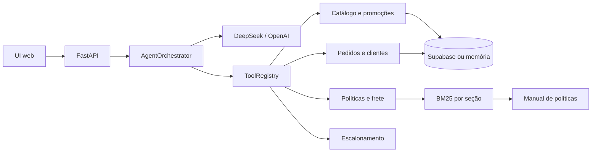

# Empório da Música — Agente de Atendimento

Agente de atendimento por mensagens de texto para a Empório da Música, loja fictícia de instrumentos musicais de Campo Grande/MS. O agente assume a persona definida no manual de políticas, consulta catálogo, estoque, promoções e pedidos em dados estruturados, responde dúvidas de política com RAG e encaminha casos sensíveis para atendimento humano.

> **Entrega do desafio:** o escopo da v1 é consulta e escalonamento. Criação de carrinho/pedido, pagamento e integração real com WhatsApp ficaram como backlog.

## O que o agente faz

- Busca instrumentos por termo, categoria e faixa de preço.
- Informa preço de tabela, promoção ativa, preço com PIX, estoque e status do produto.
- Identifica o cliente e consulta somente os pedidos vinculados a ele.
- Responde status, itens, rastreio, previsão de entrega e prazos de devolução/garantia.
- Responde políticas de horário, endereço, contato, pagamento, troca, devolução, garantia, promoções e frete.
- Recusa acessórios e assuntos fora do escopo com redirecionamento educado.
- Registra escalonamentos com motivo, resumo e status.
- Mantém histórico de conversa por sessão.

## O que o agente não faz

- Não cria pedido, não reserva estoque e não processa pagamento.
- Não vende acessórios (cordas, palhetas, cabos, cases, pedais, amplificadores).
- Não calcula frete fora da regra conhecida; nesses casos, informa que é sob cotação.
- Não compartilha dados de outros clientes.
- Não promete desconto expirado, `rain check` ou condição fora do manual.
- Não tem integração real com WhatsApp nesta versão.

## Arquitetura



O projeto segue uma arquitetura hexagonal:

- `app/domain`: entidades, portas e serviços de catálogo, pedidos, políticas, frete e conversas.
- `app/adapters`: Supabase, memória local, LLM, PDF e BM25.
- `app/agent`: orquestrador, ferramentas, prompt, guardrails e persona.
- `app/api`: rotas FastAPI, schemas Pydantic e dependências.
- `app/web`: UI vanilla de chat.
- `scripts`: ingestão, índice de políticas e runner de exemplos.
- `supabase/migrations`: schema SQL.

O domínio não conhece FastAPI, Supabase, PDF ou provedor de LLM. As ferramentas são determinísticas e o modelo apenas decide quando chamá-las e como comunicar o resultado.

## Stack e decisões

| Decisão | Escolha | Justificativa |
|---|---|---|
| Linguagem | Python 3.10+ | Restrição obrigatória do desafio. |
| Interface | FastAPI + UI vanilla | Foco no agente, baixo acoplamento e demonstração simples. |
| Abordagem | Function calling + serviços determinísticos + RAG | Evita agente SQL livre e reduz alucinação de preço, estoque e prazo. |
| LLM padrão | DeepSeek Flash | Melhor custo-benefício, contexto de 1M e suporte a tool calls. |
| Fallback | OpenAI `gpt-4o-mini` | Tool calling previsível e mesmo patamar de preço. |
| Thinking mode | Desativado por padrão | Reduz latência e custo; pode ser ativado com `LLM_THINKING=true`. |
| Dados | Supabase Postgres | Requisito do usuário; permite SQL completo e histórico. |
| Fallback local | CSVs em memória | Testes e demonstração sem credenciais. |
| RAG | BM25 por seção | Manual de 8 páginas; sem custo extra e com citação de seção/página. |
| Memória | Últimas 12 mensagens | Equilíbrio entre contexto e custo de tokens. |
| Identificação | Nome + telefone ou e-mail | Dados disponíveis e menor atrito. |
| Data de referência | `STORE_TODAY` configurável | Permite reproduzir cenários de devolução. |

### Comparativo de LLMs

Valores de tabela consultados em 03/11/2026:

| Modelo | Entrada por 1M | Saída por 1M | Contexto | Free tier | Tool calling | Observação |
|---|---:|---:|---:|---|---|---|
| DeepSeek Flash | US$ 0,15 off-peak / 0,30 peak | US$ 0,60 off-peak / 1,20 peak | 1M | Não | Sim | Melhor custo; provedor chinês exige atenção à LGPD em produção. |
| OpenAI `gpt-4o-mini` | US$ 0,15 | US$ 0,60 | 128k | Não | Sim, maduro | Maior previsibilidade de schema. |
| Gemini 3.8 Flash | Grátis no free tier / US$ 0,75 pago | Grátis / US$ 3,75 | 1M | Sim | Sim | Free tier usa dados para treino e tem rate limit. |

**Decisão:** DeepSeek Flash como padrão, OpenAI `gpt-4o-mini` como fallback. Gemini fica documentado como alternativa gratuita para desenvolvimento. O custo estimado de uma conversa de 4 turnos é de **US$ 0,001 a 0,002** no DeepSeek/OpenAI e **zero** no Gemini free tier.

### Benchmark de latência

Executado em 03/11/2026 com 3 execuções por cenário (catálogo, pedido e devolução), Supabase, DeepSeek sem thinking e `max_tokens=800`. Relatório completo em [`docs/llm_benchmark.md`](docs/llm_benchmark.md).

| Provedor | Mediana | Média | Sucesso |
|---|---:|---:|---:|
| DeepSeek | 10,71 s | 11,80 s | 9/9 |
| OpenAI `gpt-4o-mini` | 11,68 s | 12,29 s | 9/9 |

**Decisão:** manter **DeepSeek como primário** e **OpenAI como fallback**. A diferença de mediana foi de aproximadamente 1 segundo, e ambos acertaram todos os cenários. O fallback é acionado automaticamente em erro, timeout ou indisponibilidade do primário.

### RAG

O manual tem 8 páginas e seções numeradas. A estratégia implementada:

1. Extração de texto por página com `pdfplumber` (com cache em `data/policy_chunks.json`).
2. Limpeza de cabeçalhos, rodapés e números de página.
3. Chunking por seção e subseção.
4. Normalização de acentos e caixa.
5. Índice BM25 em memória, com expansão de sinônimos para devolução, troca, frete, pagamento, horário e garantia.
6. Top-3 trechos com seção e página para citação.
7. Recuperação automática quando a pergunta contém termos de política, mesmo que o modelo não chame a ferramenta.

## Dados e suposições

A base tem 65 produtos, 50 clientes, 20 pedidos, 22 itens, 9 categorias e 25 promoções. O relatório completo está em [`docs/data_quality_report.md`](docs/data_quality_report.md).

Suposições registradas:

- Campos estruturados (`name`, `price_brl`, `stock_quantity`, `status`) prevalecem sobre descrições.
- `is_active = 1` significa promoção vigente; o CSV não tem data de validade.
- Produto ativo com estoque zero é indisponível temporariamente.
- `orders.total_brl` é o valor cobrado, mesmo quando difere da soma dos itens.
- E-mails duplicados não são mesclados; a identificação pode pedir desambiguação.
- Clientes não têm CEP; frete fora da região metropolitana de Campo Grande é sob cotação.
- O prazo de devolução usa `estimated_delivery` como data de recebimento quando o pedido está entregue.
- O frete local é grátis a partir de R$ 500,00. O manual diz “acima de R$ 500,00”; o limite exato de R$ 500,00 foi tratado como gratuito.
- A loja tem dois telefones no manual; a v1 usa o WhatsApp `(67) 3321-4500` para contato e `(67) 3341-4444` como telefone fixo.
- “Histórico de negociação” foi interpretado como histórico de conversas e escalonamentos.

## Como rodar

### Pré-requisitos

- Python 3.10+
- Git
- Opcional: projeto Supabase com `SUPABASE_DB_URL`
- Opcional: chave DeepSeek (ou OpenAI)

### Setup local

```bash
git clone https://github.com/afsjr/store_music.git
cd store_music
python3 -m venv .venv
source .venv/bin/activate
pip install -r requirements.txt
cp .env.example .env
```

Edite `.env`:

```dotenv
LOCAL_MODE=true
DATA_DIR=emporio_musica/data
POLICY_PDF=emporio_musica/data/políticas_da_loja.pdf
POLICY_CACHE=data/policy_chunks.json
LLM_PROVIDER=deepseek
DEEPSEEK_MODEL=deepseek-flash
OPENAI_MODEL=gpt-4o-mini
LLM_MAX_TOKENS=800
LLM_THINKING=false
DEEPSEEK_API_KEY=sua-chave
OPENAI_API_KEY=
SUPABASE_DB_URL=
STORE_TODAY=
```

Sem `DEEPSEEK_API_KEY`, a aplicação sobe, mas o chat retorna 503 e a UI mostra um aviso. Os testes funcionam sem chave.

### Supabase (opcional)

> `SUPABASE_DB_URL` deve ser a **connection string Postgres** do painel do Supabase
> (`postgresql://...`), não a URL `https://...supabase.co` da API. Com a URL da API,
> o projeto cai automaticamente no modo local em memória.

```bash
psql "$SUPABASE_DB_URL" -f supabase/migrations/001_schema.sql
python -m scripts.ingest
```

A ingestão valida PKs, FKs, status, valores, rastreio, totais e duplicidades, e gera `docs/data_quality_report.md`. Para validar sem gravar:

```bash
python -m scripts.ingest --dry-run
```

### Índice de políticas

```bash
python -m scripts.build_policy_index
```

O comando gera `data/policy_chunks.json` e `docs/policy_index_summary.md`. A aplicação carrega o cache no startup; se ele não existir, extrai do PDF.

### Validação realizada

- Schema aplicado no Supabase e ingestão concluída com as contagens 9, 65, 50, 20, 22 e 25.
- `GET /health` em modo Supabase retornou `200` com `database: ok` e `llm: ok`.
- DeepSeek real validado em catálogo, consulta de pedido e devolução.
- Exemplos em `examples/` gerados pelo agente real com `STORE_TODAY=2026-02-20`.
- 53 testes automatizados passando; lint e format limpos.

### Subir a aplicação

```bash
uvicorn app.main:app --reload --port 8000
```

Abra `http://localhost:8000`.

### Comandos Make

```bash
make setup
make ingest
make index
make run
make test
make lint
make format
make examples
make benchmark
```

## API

### `POST /api/chat`

```json
{
  "session_id": "uuid-opcional",
  "message": "Quais violões custam até R$ 1000?"
}
```

Resposta:

```json
{
  "session_id": "uuid",
  "reply": "Encontrei estas opções...",
  "citations": [{"section": "3", "page": 3, "source": "Manual de Políticas"}],
  "handoff": false,
  "tool_calls": [{"name": "buscar_produtos", "arguments": {"preco_max": 1000}, "ok": true}]
}
```

### Outros endpoints

- `POST /api/sessions` — cria sessão.
- `GET /api/sessions/{id}/messages` — histórico.
- `GET /health` — estado do banco e do LLM.
- `GET /` — UI de chat.

Erros principais: `422` para mensagem inválida, `429` para rate limit, `503` quando o LLM não está disponível e `500` para erro inesperado.

## Exemplos

| Arquivo | Cenário |
|---|---|
| [`examples/01-catalogo.md`](examples/01-catalogo.md) | Busca de violões até R$ 1.000 e detalhe de estoque. |
| [`examples/02-preco-promocao.md`](examples/02-preco-promocao.md) | Preço, PIX e parcelamento do Takamine GD20. |
| [`examples/03-pedido.md`](examples/03-pedido.md) | Identificação e consulta do pedido 8. |
| [`examples/04-devolucao.md`](examples/04-devolucao.md) | Aplicação da política de arrependimento em 7 dias. |
| [`examples/05-fora-de-escopo.md`](examples/05-fora-de-escopo.md) | Recusa de acessórios e redirecionamento. |

Os exemplos 3 e 4 são reproduzíveis com `STORE_TODAY=2026-02-20`. Para gerar transcrições com o agente real, configure a chave e rode `make examples`.

## Testes e qualidade

```bash
python -m pytest -q
ruff check app scripts tests
ruff format --check app scripts tests
```

A suíte cobre catálogo, promoções, PIX, pedidos, privacidade, prazos, RAG, ferramentas, guardrails, loop do agente, API e ingestão. São **53 testes**, todos passando sem credenciais externas.

## Estrutura do projeto

```text
app/
  adapters/        # Supabase, memória, LLM, PDF e BM25
  agent/           # orquestrador, ferramentas, prompt e guardrails
  api/             # rotas, schemas e dependências
  domain/          # entidades, portas e serviços
  web/             # UI de chat
data/              # cache do índice de políticas
docs/              # qualidade dos dados, índice e benchmark de LLMs
examples/          # 5 conversas de referência
scripts/           # ingestão, índice, benchmark e runner de exemplos
supabase/          # migrations SQL
tests/             # testes automatizados
_reversa_sdd/      # PRD e specs SDD geradas pelo Reversa
_reversa_forward/  # requirements, roadmap, actions e interfaces
```

## Reversa

O projeto usou o Reversa como workflow de especificação:

- `_reversa_sdd/newproject-brief.md`, `ideation.md`, `personas.md`, `prd.md`.
- `_reversa_sdd/sdd/` com seis specs SDD, todas com score 100 no `spec_scorer.py`.
- `_reversa_forward/001-atendimento-mvp/` com requirements, roadmap, investigation, data-delta, onboarding, actions e interfaces.
- `AGENTS.md` e `.reversa/` mantêm o estado e as regras do framework.

## Segurança e LGPD

- A UI fala somente com o FastAPI; o Supabase não é exposto ao navegador.
- Telefone e e-mail são mascarados em logs e respostas de depuração.
- Consultas de pedido exigem identificação e vínculo com o cliente.
- Consultas SQL usam parâmetros.
- Nenhuma chave ou segredo é versionado; `.env` está no `.gitignore`.
- Em produção, seria necessário definir base legal, retenção, contrato com o provedor de LLM e política de descarte. O free tier do Gemini não deve ser usado com dados reais.

## Limitações e próximos passos

- Sem integração real com WhatsApp; a UI é uma simulação.
- Sem criação de pedido, carrinho ou pagamento.
- Sem streaming token a token; a resposta é retornada completa.
- RAG lexical; embeddings e benchmark de retrieval ficam como evolução.
- Histórico em memória é perdido ao reiniciar quando o Supabase não está configurado.
- Dados têm inconsistências documentadas; não foram corrigidos automaticamente.
- Latência medida de **10,71 s (DeepSeek)** e **11,68 s (OpenAI)** na mediana do benchmark, acima do alvo de 8 s do PRD; o provedor domina o tempo.
- O benchmark cobre 3 cenários e 3 execuções por cenário; uma avaliação maior com 20–30 cenários fica como próximo passo.
- Próximos passos: criar pedido, integrar WhatsApp, adicionar embeddings, cache de respostas e avaliar custo/latência com dados reais.

## Uso de assistentes de IA

Este projeto usou:

- **Reversa** para o pipeline de especificação: brief, ideação, personas, PRD, seis specs SDD e artefatos forward. As specs foram avaliadas pelo `spec_scorer.py` e revisadas antes da implementação.
- **opencode** como agente de codificação para implementar os módulos, escrever testes, rodar lint e corrigir falhas.
- Revisão manual do código, dos dados e das respostas de exemplo.

O uso de IA acelerou a estruturação e a implementação, mas as decisões de escopo, dados e segurança foram registradas e validadas ao longo do processo.

## Convenção de commits

- Prefixo Conventional Commits em inglês: `feat`, `fix`, `docs`, `chore`, `test`, `refactor`, `style`, `perf`, `build`, `ci`.
- Descrição e corpo em português, no imperativo, sem ponto final, com até 72 caracteres.
- Exemplos: `feat: adiciona schema Supabase e ingestão dos CSVs`, `docs: adiciona comparativo de LLMs`.
