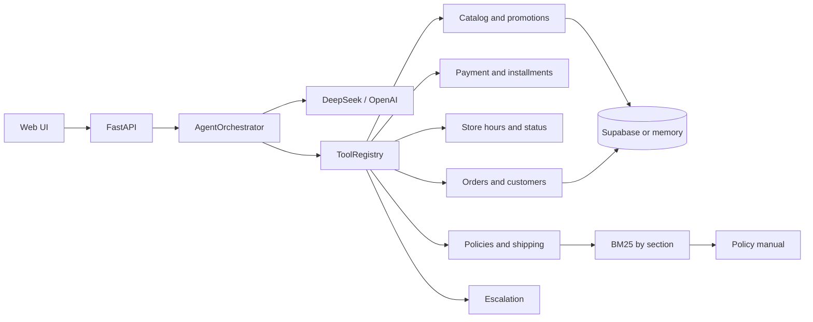

# Empório da Música — Customer Support Agent

Text-message customer support agent for Empório da Música, a fictional musical instrument store in Campo Grande/MS, Brazil. The agent adopts the persona defined in the policy manual, queries the catalog, inventory, promotions, and orders in structured data, answers policy questions with RAG, and hands sensitive cases off to human support.

> **Challenge delivery:** v1 is scoped to lookup and escalation. Cart/order creation, payment processing, and real WhatsApp integration remain backlog items.

## What the agent does

- Searches instruments by term, category, and price range.
- Reports list price, active promotion, PIX price, inventory, and product status.
- Simulates PIX, debit, installment credit, and boleto payments using deterministic rules.
- Reports whether the store is currently open and when the next support window starts.
- Suggests up to 3 available alternatives for out-of-stock or discontinued products.
- Identifies the customer and only queries orders linked to that customer.
- Answers status, items, tracking, delivery estimate, and return/warranty deadlines.
- Answers policies on hours, address, contact, payment, exchanges, returns, warranty, promotions, and shipping.
- Declines accessories and out-of-scope topics with a polite redirect.
- Records escalations with reason, summary, and status.
- Keeps per-session conversation history.

## What the agent does not do

- It does not create orders, reserve inventory, or process real payments.
- It does not sell accessories (strings, picks, cables, cases, pedals, amplifiers).
- It does not calculate shipping outside the known rule; in those cases it says the cost is by quote.
- It does not share other customers' data.
- It does not promise expired discounts, rain checks, a partner-store list, or conditions outside the manual.
- It has no real WhatsApp integration in this version.

## Architecture



The project follows a hexagonal architecture:

- `app/domain`: entities, ports, and services for catalog, orders, policies, shipping, and conversations.
- `app/adapters`: Supabase, local memory, LLM, PDF, and BM25.
- `app/agent`: orchestrator, tools, prompt, guardrails, and persona.
- `app/api`: FastAPI routes, Pydantic schemas, and dependencies.
- `app/web`: vanilla chat UI.
- `scripts`: ingestion, policy index, and example runner.
- `supabase/migrations`: SQL schema.

The domain knows nothing about FastAPI, Supabase, PDF, or the LLM provider. Tools are deterministic and the model only decides when to call them and how to communicate the result.

## Stack and decisions

| Decision | Choice | Rationale |
|---|---|---|
| Language | Python 3.10+ | Mandatory challenge constraint. |
| Interface | FastAPI + vanilla UI | Focus on the agent, low coupling, and a simple demo. |
| Approach | Function calling + deterministic services + RAG | Avoids a free-form SQL agent and reduces hallucination of price, inventory, and deadlines. |
| Default LLM | DeepSeek Flash | Best cost-benefit, 1M context, and tool-call support. |
| Fallback | OpenAI `gpt-4o-mini` | Predictable tool calling at the same price level. |
| Thinking mode | Disabled by default | Reduces latency and cost; can be enabled with `LLM_THINKING=true`. |
| Data | Supabase Postgres | User requirement; enables full SQL and history. |
| Local fallback | CSVs in memory | Tests and demos without credentials. |
| RAG | BM25 by section | 8-page manual; no extra cost and includes section/page citations. |
| Memory | Last 12 messages | Balance between context and token cost. |
| Identification | Name + phone or e-mail | Available data with the least friction. |
| Reference date | Configurable `STORE_TODAY` | Reproduces return scenarios. |

### LLM comparison

List prices checked on 2026-11-03:

| Model | Input per 1M | Output per 1M | Context | Free tier | Tool calling | Note |
|---|---:|---:|---:|---|---|---|
| DeepSeek Flash | US$ 0.15 off-peak / 0.30 peak | US$ 0.60 off-peak / 1.20 peak | 1M | No | Yes | Best cost; Chinese provider requires LGPD attention in production. |
| OpenAI `gpt-4o-mini` | US$ 0.15 | US$ 0.60 | 128k | No | Yes, mature | Higher schema predictability. |
| Gemini 3.8 Flash | Free on the free tier / US$ 0.75 paid | Free / US$ 3.75 | 1M | Yes | Yes | Free tier uses data for training and has a rate limit. |

**Decision:** DeepSeek Flash as default and OpenAI `gpt-4o-mini` as fallback. Gemini is documented as a free development alternative. The estimated cost of a 4-turn conversation is **US$ 0.001 to 0.002** on DeepSeek/OpenAI and **zero** on the Gemini free tier.

### Latency benchmark

Run on 2026-11-03 with 3 runs per scenario (catalog, order, and return), Supabase, DeepSeek without thinking, and `max_tokens=800`. Full report in [`docs/llm_benchmark.md`](docs/llm_benchmark.md).

| Provider | Median | Mean | Success |
|---|---:|---:|---:|
| DeepSeek | 10.71 s | 11.80 s | 9/9 |
| OpenAI `gpt-4o-mini` | 11.68 s | 12.29 s | 9/9 |

**Decision:** keep **DeepSeek as primary** and **OpenAI as fallback**. The median difference was about 1 second and both succeeded in every scenario. Fallback is triggered automatically on error, timeout, or primary unavailability.

### RAG

The manual has 8 pages and numbered sections. The implemented strategy:

1. Per-page text extraction with `pdfplumber` (cached in `data/policy_chunks.json`).
2. Cleanup of headers, footers, and page numbers.
3. Chunking by section and subsection.
4. Accent and case normalization.
5. In-memory BM25 index with synonym expansion for returns, exchanges, shipping, payment, hours, and warranty.
6. Top-3 passages with section and page for citation.
7. Automatic retrieval when the question contains policy terms, even if the model does not call the tool.

## Data and assumptions

The dataset has 65 products, 50 customers, 20 orders, 22 items, 9 categories, and 25 promotions. The full report is in [`docs/data_quality_report.md`](docs/data_quality_report.md).

Recorded assumptions:

- Structured fields (`name`, `price_brl`, `stock_quantity`, `status`) prevail over descriptions.
- `is_active = 1` means an active promotion; the CSV has no expiration date.
- An active product with zero stock is temporarily unavailable.
- `orders.total_brl` is the charged amount, even when it differs from the sum of the items.
- Duplicate e-mails are not merged; identification may ask for disambiguation.
- Customers have no ZIP code; shipping outside the Campo Grande metropolitan area is by quote.
- The return deadline uses `estimated_delivery` as the receipt date when the order is delivered.
- Local shipping is free from R$ 500.00. The manual says “above R$ 500.00”; the exact R$ 500.00 threshold was treated as free.
- The manual lists two phone numbers; v1 uses WhatsApp `(67) 3321-4500` for contact and `(67) 3341-4444` as the landline.
- “Negotiation history” was interpreted as conversation and escalation history.
- Payment: purchases below R$ 50.00 may only be paid in 1 installment; 4x–6x require a minimum installment of R$ 80.00; 7x–12x require R$ 100.00; PIX + card combination above R$ 2,000.00 is informational only, without automatic calculation.
- Expired promotions: since the CSV has no expiration date, `is_active = 0` and the highest `promotion_id` identify the last known promotion.
- Hours: status uses the `America/Campo_Grande` timezone and the regular hours from the manual; holidays and special dates are not in the calendar and are reported as a limitation.
- Catalog: the agent knows the 65 supplied products, not the 300+ instruments mentioned in the manual.
- Items marked “final sale” or customized have no flag in the CSVs; when that distinction is required, the agent states the limitation and offers escalation.
- Manufacturer warranty varies by product and is not in the dataset; the agent cites the legal warranty and tells the customer to check the certificate.

## Policy coverage

| Manual section | How it is handled | Test |
|---|---|---|
| 1, 1.1, 1.2 — company and founding | `informacoes_loja` + RAG | `test_policy_coverage` |
| 2 — hours and after-hours support | `status_loja` + RAG | `test_store_hours` |
| 3 and 3.1 — payment and installments | deterministic `simular_pagamento` | `test_payments` |
| 4.1 and 4.2 — regret and defect | `OrderService` + RAG | `test_orders` |
| 4.3 and 4.4 — preference and non-eligible items | RAG + prompt; insufficient data triggers escalation | `test_policy_coverage` |
| 5.1 — local shipping | `calcular_frete` | `test_tools` |
| 5.2 and 5.3 — other cities and tracking | RAG + quote + order data | `test_policy_coverage` |
| 6.1 and 6.2 — promotions and rules | `consultar_promocao` + prompt | `test_promotions` |
| 7.1 and 7.3 — support and special situations | `status_loja`, `buscar_alternativas` + RAG | `test_store_hours`, `test_alternatives` |
| 8.1, 8.2 and 8.3 — warranty | `consultar_pedido` + RAG | `test_policy_coverage` |
| 9 — LGPD | RAG + privacy guardrails | `test_policy_coverage`, `test_tools` |

## How to run

### Prerequisites

- Python 3.10+
- Git
- Optional: Supabase project with `SUPABASE_DB_URL`
- Optional: DeepSeek key (or OpenAI)

### Local setup

```bash
git clone https://github.com/afsjr/store_music.git
cd store_music
make setup
cp .env.example .env
```

`requirements.txt` pins `pypdfium2==5.11.0` to keep the wheel compatible with macOS 12 x86_64; 5.12+ requires macOS 13 and tries to build through an SSL download. On Linux, macOS 13+, and Windows, the matching wheel is used normally.

Edit `.env`:

```dotenv
LOCAL_MODE=true
DATA_DIR=emporio_musica/data
POLICY_PDF=emporio_musica/data/políticas_da_loja.pdf
POLICY_CACHE=data/policy_chunks.json
LLM_PROVIDER=deepseek
DEEPSEEK_MODEL=deepseek-flash
OPENAI_MODEL=gpt-4o-mini
LLM_MAX_TOKENS=800
LLM_THINKING=false
DEEPSEEK_API_KEY=your-key
OPENAI_API_KEY=
SUPABASE_DB_URL=
STORE_TODAY=
```

Without `DEEPSEEK_API_KEY`, the application starts but chat returns 503 and the UI displays a warning. Tests work without a key.

### Supabase (optional)

> `SUPABASE_DB_URL` must be the **Postgres connection string** from the Supabase
> dashboard (`postgresql://...`), not the API URL `https://...supabase.co`. With the
> API URL, the project automatically falls back to local memory mode.

```bash
psql "$SUPABASE_DB_URL" -f supabase/migrations/001_schema.sql
python -m scripts.ingest
```

Ingestion validates PKs, FKs, statuses, values, tracking, totals, and duplicates, and generates `docs/data_quality_report.md`. To validate without writing:

```bash
python -m scripts.ingest --dry-run
```

### Policy index

```bash
python -m scripts.build_policy_index
```

The command generates `data/policy_chunks.json` and `docs/policy_index_summary.md`. The application loads the cache at startup; if it does not exist, it extracts from the PDF.

### Validation performed

- Schema applied to Supabase and ingestion completed with counts 9, 65, 50, 20, 22, and 25.
- `GET /health` in Supabase mode returned `200` with `database: ok` and `llm: ok`.
- Real DeepSeek validated on catalog, order lookup, return, payment, and hours.
- `examples/` generated by the real agent with `STORE_TODAY=2026-02-20`.
- 151 automated tests passing; lint and format clean.

### Running the application

```bash
uvicorn app.main:app --reload --port 8000
```

Open `http://localhost:8000`.

### Make commands

```bash
make setup
make ingest
make index
make run
make test
make lint
make format
make examples
make benchmark
```

## API

### `POST /api/chat`

```json
{
  "session_id": "optional-uuid",
  "message": "Which guitars cost up to R$ 1000?"
}
```

Response:

```json
{
  "session_id": "uuid",
  "reply": "I found these options...",
  "citations": [{"section": "3", "page": 3, "source": "Policy Manual"}],
  "handoff": false,
  "tool_calls": [{"name": "buscar_produtos", "arguments": {"preco_max": 1000}, "ok": true}]
}
```

### Other endpoints

- `POST /api/sessions` — creates a session.
- `GET /api/sessions/{id}/messages` — history.
- `GET /health` — database and LLM status.
- `GET /` — chat UI.

Main errors: `422` for invalid message, `429` for rate limit, `503` when the LLM is unavailable, and `500` for unexpected errors.

## Examples

| File | Scenario |
|---|---|
| [`examples/01-catalogo.md`](examples/01-catalogo.md) | Search for guitars up to R$ 1,000 and inventory detail. |
| [`examples/02-preco-promocao.md`](examples/02-preco-promocao.md) | Price, expired promotion, PIX, and installments for the Takamine GD20. |
| [`examples/03-pedido.md`](examples/03-pedido.md) | Identification and lookup of order 8. |
| [`examples/04-devolucao.md`](examples/04-devolucao.md) | Applying the 7-day regret policy. |
| [`examples/05-fora-de-escopo.md`](examples/05-fora-de-escopo.md) | Declining accessories without promising a partner list, with handoff to the team. |

Examples 3 and 4 are reproducible with `STORE_TODAY=2026-02-20`. To generate transcripts with the real agent, configure the key and run `make examples`.

## Tests and quality

```bash
python -m pytest -q
ruff check app scripts tests
ruff format --check app scripts tests
```

The suite covers catalog, promotions, PIX, installments, hours, alternatives, out-of-scope, orders, privacy, deadlines, RAG, tools, guardrails, agent loop, API, and ingestion. There are **151 tests**, all passing without external credentials.

## Project structure

```text
app/
  adapters/        # Supabase, memory, LLM, PDF, and BM25
  agent/           # orchestrator, tools, prompt, and guardrails
  api/             # routes, schemas, and dependencies
  domain/          # entities, ports, and services
  web/             # chat UI
data/              # policy index cache
docs/              # data quality, index, and LLM benchmark
examples/          # 5 reference conversations
scripts/           # ingestion, index, benchmark, and example runner
supabase/          # SQL migrations
tests/             # automated tests
_reversa_sdd/      # PRD and SDD specs generated by Reversa
_reversa_forward/  # requirements, roadmap, actions, and interfaces
```

## Reversa

The project used Reversa as its specification workflow:

- `_reversa_sdd/newproject-brief.md`, `ideation.md`, `personas.md`, `prd.md`.
- `_reversa_sdd/sdd/` with six SDD specs, all scoring 100 in `spec_scorer.py`.
- `_reversa_forward/001-atendimento-mvp/` with requirements, roadmap, investigation, data-delta, onboarding, actions, and interfaces.
- `AGENTS.md` and `.reversa/` keep the framework state and rules.

## Security and LGPD

- The UI only talks to FastAPI; Supabase is not exposed to the browser.
- Phone and e-mail are masked in logs and debug responses.
- Order lookups require identification and a link to the customer.
- SQL queries use parameters.
- No key or secret is versioned; `.env` is in `.gitignore`.
- In production, it would be necessary to define a legal basis, retention, LLM provider contract, and deletion policy. The Gemini free tier must not be used with real data.

## Limitations and next steps

- No real WhatsApp integration; the UI is a simulation.
- No order creation, cart, or real payment processing; `simular_pagamento` only calculates conditions.
- No token-by-token streaming; the response is returned in full.
- Lexical RAG; embeddings and retrieval benchmarking remain future work.
- In-memory history is lost on restart when Supabase is not configured.
- The manual's 5-minute SLA is not monitored; the agent reports the next support window but does not measure queue or real time.
- Holidays and special hours are not in the calendar; the agent states the limitation and does not invent exceptions.
- The catalog covers the 65 supplied products, not the 300+ instruments mentioned in the manual.
- There is no ZIP code, weight, or dimensions per product; shipping outside the metropolitan area is by quote.
- There is no manufacturer-specific warranty, partner-store list, or “final sale”/customization flags in the CSVs.
- The data has documented inconsistencies; they were not fixed automatically.
- Measured latency of **10.71 s (DeepSeek)** and **11.68 s (OpenAI)** at the benchmark median, above the 8 s PRD target; the provider dominates the time.
- The benchmark covers 3 scenarios and 3 runs per scenario; a larger evaluation with 20–30 scenarios is a next step.
- Next steps: order creation, WhatsApp integration, embeddings, response cache, catalog expansion, and cost/latency evaluation with real data.

## Use of AI assistants

This project used:

- **Reversa** for the specification pipeline: brief, ideation, personas, PRD, six SDD specs, and forward artifacts. The specs were scored by `spec_scorer.py` and reviewed before implementation.
- **opencode** as the coding agent to implement modules, write tests, run lint, and fix failures.
- Manual review of code, data, and example responses.

AI use accelerated structuring and implementation, but scope, data, and security decisions were recorded and validated throughout the process.

## Commit convention

- Conventional Commits prefix in English: `feat`, `fix`, `docs`, `chore`, `test`, `refactor`, `style`, `perf`, `build`, `ci`.
- Description and body in Portuguese, imperative, no trailing period, up to 72 characters.
- Examples: `feat: adiciona schema Supabase e ingestão dos CSVs`, `docs: adiciona comparativo de LLMs`.
